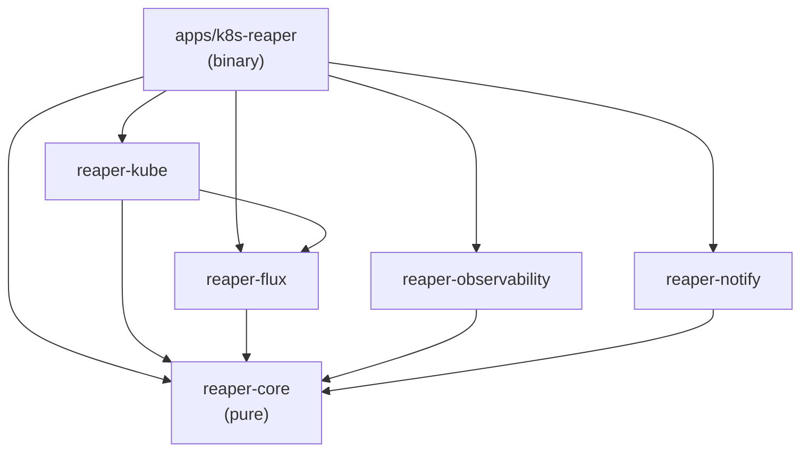
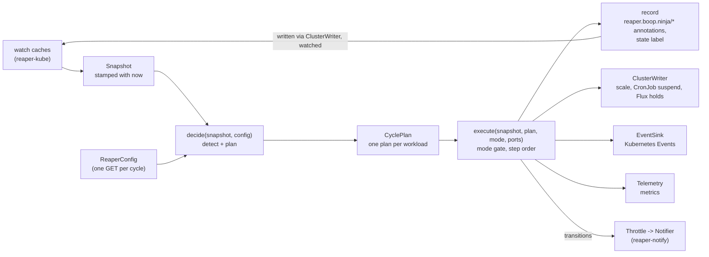

# Contributing to k8s-reaper

This is the detailed guide for working on k8s-reaper: setup, architecture,
tests, the `make` targets, releases and commits. The [README](README.md) stays
short and user-facing. Anything a user has to learn goes in
[`docs/guides/`](docs/guides/).

## Contents

- [Repository layout](#repository-layout)
- [Developer setup](#developer-setup)
  - [Toolchain](#toolchain)
  - [Dev cluster tools](#dev-cluster-tools)
  - [Dev cluster](#dev-cluster)
  - [The dev guard](#the-dev-guard)
- [Architecture](#architecture)
  - [Crate dependencies](#crate-dependencies)
  - [reaper-core](#reaper-core)
  - [reaper-kube](#reaper-kube)
  - [reaper-flux](#reaper-flux)
  - [reaper-observability](#reaper-observability)
  - [reaper-notify](#reaper-notify)
  - [apps/k8s-reaper](#appsk8s-reaper)
  - [One cycle](#one-cycle)
  - [Decisions](#decisions)
- [Adding things](#adding-things)
  - [A config field](#a-config-field)
  - [A skip reason](#a-skip-reason)
  - [A metric](#a-metric)
  - [A notification provider](#a-notification-provider)
- [Testing](#testing)
  - [Unit and contract tests](#unit-and-contract-tests)
  - [Clippy](#clippy)
  - [Dev-cluster stories](#dev-cluster-stories)
- [Make targets](#make-targets)
  - [Build hygiene](#build-hygiene)
- [Release process](#release-process)
- [Documentation map](#documentation-map)
- [Commits](#commits)
  - [Spec-kit workflow](#spec-kit-workflow)
  - [Subject style](#subject-style)
- [License](#license)

## Repository layout

```text
.
├── apps/
│   └── k8s-reaper/        the binary: clap flags, wiring, the run loop, dev-cluster stories (tests/)
├── crates/
│   ├── reaper-core/       pure decision logic; no Kubernetes, no runtime, no clock
│   ├── reaper-kube/       kube-rs adapter: watch caches, writes, Events, the ReaperConfig CRD
│   ├── reaper-flux/       Flux adapter: minimal HelmRelease type and hold patches
│   ├── reaper-observability/  tracing, metrics (Prometheus + OTel), /healthz /readyz /metrics
│   └── reaper-notify/     notification delivery: Discord, Slack, webhooks, SMTP
├── deploy/dev/            dev cluster: k3d config, fixtures, Flux payloads, notify catchers
├── docs/guides/           user guides (everything a user learns)
├── specs/                 spec-kit features: spec, plan, research, data model, contracts, tasks
├── .specify/              spec-kit config, templates, scripts and the constitution
├── .github/workflows/     ci.yml (fmt, clippy, test, image build) and release.yml (tag -> image push)
├── Makefile               developer tasks; `make help` lists them
├── Dockerfile             multi-stage image: cargo-chef, then distroless
├── Cargo.toml             workspace: members, shared dependencies, lints, release profile
├── rust-toolchain.toml    pinned Rust channel and components
└── clippy.toml            doc-valid-idents for Kubernetes and Flux kind names
```

The CRD golden file is `crates/reaper-kube/tests/golden/crd.yaml`, next to the
test that checks it. There is no top-level `tests/` directory.

## Developer setup

### Toolchain

- **Rust 1.99**, edition 2024. `rust-toolchain.toml` pins the channel and the
  `rustfmt` and `clippy` components, so `rustup` installs them on first use.
- **cargo-sweep** (optional). `make gc` uses it to clear stale `target/`
  output. If it is missing, `make gc` prints a note and continues. Install it
  with:

  ```sh
  cargo install cargo-sweep --locked
  ```

- **Docker**, to build the image and to run a dev cluster.

That is enough for `make build` and `make test`.

### Dev cluster tools

The integration stories run against a local cluster with Flux. They need, on
`PATH`:

- `kubectl`;
- `kind` or `k3d` (v5);
- the Flux CLI (`flux`), 2.7 or later;
- `helm`, to package and push the fixture chart.

### Dev cluster

[`deploy/dev/README.md`](deploy/dev/README.md) has the full walk-through and
the fixture table. In short:

```sh
# A new k3d cluster with Flux, a registry and the fixtures
make dev-cluster
make image dev-load dev-run

# Or an existing kind cluster that already runs Flux
make dev-kind image dev-load dev-run KUBE_CONTEXT=kind-<name>
```

- `make dev-cluster` creates a k3d cluster from `deploy/dev/k3d.yaml` (which
  also creates the `k3d-reaper-registry` registry on `localhost:5001`),
  installs Flux (`FLUX_VERSION`, default `v2.7.0`) and runs `make
  dev-fixtures`.
- `make dev-kind` does not install Flux. It starts a registry container
  (`k3d-reaper-registry`) on the `kind` network at `localhost:5001`, then runs
  `make dev-fixtures`.
- `make dev-fixtures` applies the ReaperConfig CRD (printed by `k8s-reaper
  crd`), pushes the Flux payloads (`make dev-push`), applies `deploy/dev` and
  breaks the `partial/rollout` fixture.
- `make image` builds `k8s-reaper:dev`. `make dev-load` loads it into the
  cluster. `make dev-run` applies `deploy/dev/reaper.yaml` and restarts the
  reaper in the `k8s-reaper` namespace, in report mode.
- `make dev-push` re-pushes the Flux fixture payloads after you change them.
- `make dev-notify` adds the notification catchers (an echo webhook and
  Mailpit in `notify-dev`), the channel Secret, and patches the dev
  ReaperConfig to send `ReapPlanned`.
- `make dev-clean` removes what `dev-kind` added and keeps the cluster.
  `make dev-down` deletes the k3d cluster and its registry.

### The dev guard

Every dev target names its cluster through `KUBE_CONTEXT` and passes it to
`kubectl` and `flux` as `--context`. The current kube context is never used.
The default is `k3d-k8s-reaper-dev`, the cluster `make dev-cluster` creates.
On kind, pass `KUBE_CONTEXT=kind-<name>` to every command.

There are two checks, so a dev command cannot reach a real cluster by
accident:

- The `dev-guard` Make target refuses any `KUBE_CONTEXT` that does not start
  with `kind-` or `k3d-`. Most dev targets and `test-integration` depend on
  it. (`dev-registry`, `dev-push` and `dev-down` do not touch a kube context.)
- The integration tests (`apps/k8s-reaper/tests/common/mod.rs`) repeat that
  check, and also refuse a context whose API server is not on loopback
  (`127.0.0.1`, `localhost`, `0.0.0.0` or `[::1]`).

A kind or k3d name alone is not proof of a local cluster. The loopback check
catches a context named `kind-…` that points somewhere else.

## Architecture

k8s-reaper uses ports and adapters (hexagonal architecture). One pure core
decides what to do. Adapters connect it to Kubernetes, Flux, telemetry and
notification channels. The binary wires them together.

### Crate dependencies

Arrows point from a crate to what it depends on (checked against each
`Cargo.toml`). Everything depends on `reaper-core`; `reaper-core` depends on
none of them.



| Crate | Role | May depend on | Implements |
| ----- | ---- | ------------- | ---------- |
| `reaper-core` | The decision: detect, decide, plan, execute through ports | `serde`, `serde_json`, `thiserror` only | the ports themselves, plus fakes in `testing` |
| `reaper-kube` | Kubernetes in and out | `reaper-core`, `reaper-flux`, kube-rs, k8s-openapi, tokio | `ClusterWriter`, `EventSink` |
| `reaper-flux` | The Flux HelmRelease type and hold patch body | `reaper-core`, kube-rs, k8s-openapi | (used by `reaper-kube`) |
| `reaper-observability` | Logs, traces, metrics, health server | `reaper-core`, axum, OpenTelemetry, prometheus-client, tokio | `Telemetry` |
| `reaper-notify` | Notification delivery | `reaper-core`, reqwest, lettre, rustls, tokio | `Notifier` |
| `k8s-reaper` | Flags, wiring, the loop | every crate above, clap, anyhow | nothing; holds no decision logic |

Adapters do not depend on each other, with one exception: `reaper-kube` uses
`reaper-flux` for the HelmRelease type it watches and patches.

### reaper-core

`crates/reaper-core` is plain data in, plain data out.

- It depends only on `serde`, `serde_json` and `thiserror`.
- It has no Kubernetes client or types, no async runtime and no clock. Time is
  `Timestamp(i64)` (`time.rs`), and "now" is always a parameter, carried in
  the snapshot.
- Ports are traits in `ports.rs` (`ClusterWriter`, `EventSink`, `Telemetry`)
  and `notify.rs` (`Notifier`). The async ones return `Send` futures, so the
  core names no runtime.
- `testing.rs` has fixture builders and fakes (`FakeWriter`, `FakeEvents`,
  `FakeTelemetry`) for tests.

`crates/reaper-core/tests/no_infra_deps.rs` enforces this. It reads `cargo
metadata` and fails if `kube`, `kube-client`, `kube-runtime`, `k8s-openapi`,
`tokio`, `chrono`, `jiff` or `time` show up in the core's dependency tree.

| Module | What it holds |
| ------ | ------------- |
| `model` | The input: `Snapshot` and its views (`WorkloadView`, `PodView`, `CronJobView`, `HelmReleaseView`, …), `WorkloadRef`, `ObjectRef`. |
| `config` | `Config` with defaults, `RawConfig` (the CRD spec as plain options), `Config::from_raw` validation, `Mode`. |
| `config_state` | `ConfigState`: the last valid config stays active; change reporting (`ConfigApplied`, `ConfigInvalid`). |
| `detect` | Crash-loop classification, owner resolution, CronJob failing streaks. |
| `decide` | `decide(snapshot, config) -> CyclePlan`: one plan per workload. The global mode is not an input. |
| `plan` | The output: `CyclePlan`, `Plan`, `Action`, `SkipReason`, `Transition`, and the published plan JSON. |
| `executor` | `execute(...)`: runs a plan through the ports; the mode gate stops before any mutating `Action`. |
| `record` | The annotation and label codec for `reaper.boop.ninja/*`: `WorkloadRecord`, `MetadataPatch`, `State`. |
| `hold` | The reference-counted HelmRelease hold: which merge patch places or releases it. |
| `notify` | `Notification`, the `Notifier` port, and `Throttle` (global filter and `minInterval`). |
| `ports` | `ClusterWriter`, `EventSink`, `Telemetry`, and their data types. |
| `glob` | `*` and `?` matching for namespace patterns. |
| `time` | `Timestamp`, duration parsing and formatting (Go/Flux form: `90s`, `1h30m`). |
| `testing` | Builders and in-memory fakes. Not used by the running reaper. |

### reaper-kube

`crates/reaper-kube`, the kube-rs adapter. It turns Kubernetes objects into
core views and core writes into API calls.

| Module | What it holds |
| ------ | ------------- |
| `snapshot` | `Caches`: reflectors for Pods, Namespaces, ReplicaSets, Deployments, StatefulSets, DaemonSets, CronJobs, Jobs, and (when installed) HelmReleases and KEDA ScaledObjects. `Caches::snapshot(now)` and the pure mapping functions (`build_snapshot`, `pod_view`, …) the contract tests exercise. `Caches::triggered()` wakes the loop early on a watched change. |
| `writer` | `KubeWriter`, the `ClusterWriter`: JSON merge patches with a `resourceVersion` precondition, including the `scale` subresource. |
| `events` | `KubeEventSink`, the `EventSink` over `events.k8s.io/v1`; an identical repeat bumps the series, a new note is a new Event. |
| `crd` | The `ReaperConfig` CRD type (`ReaperConfigSpec`, `ReaperConfigStatus`), its schema rules, `to_raw()` into the core, and `crd_yaml()`. |
| `config_watch` | `ConfigSource`: one GET of the ReaperConfig per cycle (not a watch), fed to `ConfigState`, and the status write. |

### reaper-flux

`crates/reaper-flux`, the Flux side of the wire.

| Module | What it holds |
| ------ | ------------- |
| `helmrelease` | A minimal `HelmRelease` (`helm.toolkit.fluxcd.io/v2`): metadata and `spec.suspend` only. `gvk()`, `api_resource()`. |
| `holds` | `merge_body()`: the JSON merge patch for a hold or release, with its `resourceVersion` precondition. |

What goes into the patch is decided by `reaper_core::hold`, which is pure.
This crate only shapes it.

### reaper-observability

`crates/reaper-observability`, everything an operator watches.

| Module | What it holds |
| ------ | ------------- |
| `telemetry` | `Metrics`, the `Telemetry` impl: a `prometheus-client` registry, mirrored to OpenTelemetry meters from the global meter provider. Also the process-level recorders the binary calls (`cycle`, `config`, `notification`, …). |
| `tracing` | `init(LogFormat)`: JSON or text logs on stdout, filtered by `RUST_LOG`; OTLP span and metric export when `OTEL_EXPORTER_OTLP_ENDPOINT` is set. |
| `http` | `Health`, `router()` and `serve()`: axum server for `/healthz`, `/readyz` and `/metrics`. |

### reaper-notify

`crates/reaper-notify`, notification delivery.

| Module | What it holds |
| ------ | ------------- |
| `channels` | `load_dir()` and `parse_channel()`: one channel per file in the mounted Secret; `Provider` (`discord`, `slack`, `generic`, `email`) inferred from the URL or `?format=`. |
| `payload` | Pure functions: the body each provider receives. |
| `worker` | `NotifyHandle`, the `Notifier`: a bounded queue (oldest dropped when full) and a background worker with retries. `start()`, `set_channels()`, `shutdown()`. |
| `secret` | `Secret<T>`: a channel URL is a credential and never appears in `Debug`, errors or logs. |

A slow channel never delays a cycle.

### apps/k8s-reaper

The binary is a thin layer. It has two subcommands: `run` (the default) and
`crd`, which prints the CRD YAML. `src/main.rs` holds the clap flags
(`RunArgs`); `src/run.rs` builds the adapters and runs the loop. It holds no
decision logic. The flags and their environment variables are listed in
[`contracts/config.md`](specs/001-crashloop-reaper/contracts/config.md#process-flags--environment).

### One cycle

The cycle is snapshot, decide, execute, record. The reaper keeps all of its
state in `reaper.boop.ninja/*` annotations and one label on the objects it
touches, so the record written in one cycle is what the next snapshot reads
back. There is no other store.



1. The kube adapter takes a snapshot from its caches, stamped with "now".
2. The binary reads the ReaperConfig (`ConfigSource::refresh`) and keeps the
   last valid one active.
3. `decide()` runs detection and returns a plan per workload: observe,
   candidate, reap steps, restore steps, or a skip with a reason. The decision
   is the same in report and full mode.
4. `execute()` runs the plan through the ports. It first writes the record
   (state label, timestamps, plan annotation), identically in both modes. The
   mode gate is the only branch between modes: report mode writes only the
   reaper's own annotations, labels and Events; full mode also scales,
   suspends CronJobs and applies the Flux holds.
5. The transitions the executor returns are throttled and handed to the
   notifier. The binary records cycle metrics and readiness, and writes the
   ReaperConfig status.

A cycle runs every `cycleInterval`, or sooner when a watched change asks for
one (for example, a restore request), but never within 2 s of the last one
(`MIN_GAP` in `run.rs`).

### Decisions

The reasoning behind the design is written down once. Read it there, not here:

- [`specs/001-crashloop-reaper/research.md`](specs/001-crashloop-reaper/research.md):
  the decision log (R1 to R13), with alternatives considered.
- [Owner Decisions](specs/001-crashloop-reaper/spec.md#owner-decisions) in
  `spec.md`: the answers the owner gave to open questions.
- [`plan.md`](specs/001-crashloop-reaper/plan.md): the constitution check and
  complexity tracking.
- [`contracts/`](specs/001-crashloop-reaper/contracts/): the public contracts
  (annotations, labels, config, Events, metrics, notifications).
- [`.specify/memory/constitution.md`](.specify/memory/constitution.md): the
  project rules.

A change to a public contract updates the matching file in `contracts/`, and
the user guide, in the same change. A change that adds a new kind of mutation
adds its reversal and its report-mode equivalent in the same change.

## Adding things

Recipes for the common changes. Each lists every place that has to move
together. Write the core test first.

### A config field

A field on the `ReaperConfig` spec, for example `spec.detection.foo`.

1. **Core.** In `crates/reaper-core/src/config.rs`: add the typed field to
   the right block (`Detection`, `Scope`, `Limits`, …) with its default in
   `Default`, add the `Option` to `RawConfig`, validate it in
   `Config::from_raw` (push a `FieldError` with the CRD path, e.g.
   `spec.detection.foo`), and map it back in `Config::to_raw`. The round-trip
   test (`from_raw(to_raw(c)) == c`) must still pass. Add a range constant
   next to the others if it has one.
2. **CRD.** In `crates/reaper-kube/src/crd.rs`: add the field to the spec
   struct (`Option<…>`, `#[serde(default, skip_serializing_if =
   "Option::is_none")]`), repeat the range or pattern with `#[schemars(…)]` so
   the API server rejects bad values first, write a doc comment (it becomes
   the CRD description), and map it in `ReaperConfigSpec::to_raw`.
3. **Golden file.** Regenerate and review the diff:

   ```sh
   UPDATE_GOLDEN=1 cargo test -p reaper-kube --test crd_golden
   git diff crates/reaper-kube/tests/golden/crd.yaml
   ```

4. **Use it** in `decide.rs` (or wherever it applies), with table-driven tests
   built from `testing.rs`.
5. **Contract.** Update the `ReaperConfig` section of
   [`contracts/config.md`](specs/001-crashloop-reaper/contracts/config.md) and
   the config table in
   [`data-model.md`](specs/001-crashloop-reaper/data-model.md).
6. **Guide.** Add a row to the field reference in
   [`docs/guides/configuration.md`](docs/guides/configuration.md): name, type,
   default, range, meaning.
7. **Chart** (in `mbround18/helm-charts`). `reaperConfig.spec` in
   `charts/k8s-reaper/values.yaml` is free-form, so a new field needs no new
   value. The chart's CRD does need regenerating; see
   [Release process](#release-process).

### A skip reason

A new reason a candidate is not acted on.

1. **Core.** Add the variant to `SkipReason` in
   `crates/reaper-core/src/plan.rs` and its string in `SkipReason::as_str`.
   The string is public: it appears in the plan annotation
   (`{"skip":"…"}`), the `ReapSkipped` Event note, and the `reason` label of
   `reaper_workload_skipped`.
2. **Decide.** Produce it in `crates/reaper-core/src/decide.rs`. Per-workload
   reasons are an `if`/`else if` chain in `candidate_plan`, so order matters:
   the first that applies wins. The limits (`RateLimited`,
   `ReapCeilingReached`) are applied afterwards, across the whole cycle. Add a
   test next to the existing `skip_reason`/`skip_of` tests.
3. **Spec.** Add it to the `SkipReason` line in
   [`data-model.md`](specs/001-crashloop-reaper/data-model.md) and to the
   requirement in `spec.md` that lists skip reasons. The Events and metrics
   contracts use `<SkipReason>` generically and need no change.
4. **Guides.** Add a row to the skip-reason table that users read
   ([`docs/guides/how-it-works.md`](docs/guides/how-it-works.md), and the one
   in [`getting-started.md`](docs/guides/getting-started.md) while it has
   one), and a troubleshooting entry if a user can act on it.

### A metric

Decide first which kind it is:

- **Per workload or per action**, recorded during `execute()`: it goes
  through the `Telemetry` port. Add the method to `Telemetry` in
  `crates/reaper-core/src/ports.rs`, record it in `FakeTelemetry`
  (`crates/reaper-core/src/testing.rs`), call it from `executor.rs`, and
  implement it on `Metrics`.
- **Process-level** (cycles, config, notifications): add an inherent method on
  `Metrics` and call it from `apps/k8s-reaper/src/run.rs`. The core does not
  change.

Then, in `crates/reaper-observability/src/telemetry.rs`:

1. Add the `prometheus-client` family to `Metrics` and register it in
   `Metrics::register`. Counters are registered without `_total`;
   `prometheus-client` appends it.
2. Mirror it as an OpenTelemetry instrument: the Prometheus name with `.` for
   `_` and no `_total` (e.g. `reaper.actions`).
3. Add the exposed name, type and label names to the `CONTRACT` table in the
   tests. `exposition_has_exactly_the_contracted_metrics` fails until the
   two agree.

Then the documents:

4. [`contracts/metrics.md`](specs/001-crashloop-reaper/contracts/metrics.md):
   the metric row, and an alert row if it needs one.
5. [`docs/guides/monitoring.md`](docs/guides/monitoring.md): what it means and
   how to use it.
6. An alert goes in the chart's `templates/prometheusrule.yaml` in
   `mbround18/helm-charts`, with a runbook entry in the monitoring guide.

Label values must stay bounded. Never put a channel URL, an Event note or a
pod name in a label.

### A notification provider

Providers live in `crates/reaper-notify`.

1. **Provider.** Add the variant to `Provider` in `src/channels.rs`, its
   string in `Provider::as_str` (it is the `provider` metric label), and how
   it is chosen: a host rule in `infer()` and/or a `?format=` value in
   `parse_channel()`. Update the `ChannelError::Format` message if you add a
   format. A new URL scheme also needs a `Target` variant.
2. **Payload.** Add a pure function to `src/payload.rs` that builds the body
   from a `Notification` and the cluster name.
3. **Delivery.** Dispatch it in `send()` in `src/worker.rs`. Keep the URL
   inside `Secret`; never log it or put it in an error.
4. **Tests.** `tests/channels.rs` for URL parsing and inference;
   `tests/delivery.rs` for the payload shape and retry behaviour against the
   local axum server.
5. **Contract.** [`contracts/notifications.md`](specs/001-crashloop-reaper/contracts/notifications.md):
   the URL-to-provider table and the payload.
6. **Guide.** A provider section in
   [`docs/guides/notifications.md`](docs/guides/notifications.md).
7. **Dev cluster** (optional). A catcher in `deploy/dev/notify/` and a check
   in `apps/k8s-reaper/tests/us6_notify.rs`.

## Testing

There are two tiers: the fast suite, which runs everywhere, and the dev-cluster
stories, which you run on purpose.

### Unit and contract tests

```sh
make test
```

This runs `make lint` first, then `cargo test --workspace --locked`.
`make lint` runs:

- `cargo fmt --all -- --check`;
- `cargo clippy --workspace --all-targets --locked -- -D warnings`.

What the suite covers:

- **Core unit tests.** Table-driven tests in `reaper-core`, built from the
  `testing.rs` builders, with time as a parameter. Write these first when you
  change core behaviour.
- **Report mode is a dry run.** `crates/reaper-core/tests/equivalence.rs`
  checks that report and full mode publish the same plan, and that report
  mode writes nothing but `reaper.boop.ninja/*` metadata (SC-004).
- **No infrastructure in the core.** `crates/reaper-core/tests/no_infra_deps.rs`
  (see [reaper-core](#reaper-core)).
- **Plan JSON snapshots.** `plan.rs` uses `insta` inline snapshots for the
  published plan JSON. If you change the shape on purpose, update the inline
  snapshot and review the diff (`cargo insta review` if you have
  `cargo-insta`). Pending `*.pending-snap` files are git-ignored.
- **Metrics contract.** `telemetry.rs` checks the exposed names, types and
  label sets against its `CONTRACT` table.
- **Adapter contract tests.**
  - `crates/reaper-kube/tests/snapshot.rs` maps recorded objects in
    `crates/reaper-kube/tests/fixtures/` to the core's views, with no API
    server. The fixtures were taken from live objects and scrubbed: uids are
    fake (`00000000-0000-4000-8000-…`). Keep it that way when you add one.
  - `writer.rs`, `events.rs` and `config_watch.rs` (same directory) assert
    the HTTP requests against a `tower-test` mock API server.
  - `crd_golden.rs` compares the CRD YAML to
    `crates/reaper-kube/tests/golden/crd.yaml`. The chart ships that YAML, so
    any change must show up as a diff. Regenerate with
    `UPDATE_GOLDEN=1 cargo test -p reaper-kube --test crd_golden` and review
    it.
  - `crates/reaper-flux/tests/holds.rs` covers the HelmRelease hold patches.
  - `crates/reaper-notify/tests/` covers channel URL parsing
    (`channels.rs`) and delivery against a local server (`delivery.rs`).
- **Benchmark.** `crates/reaper-core/benches/decide.rs` times `decide()`
  (`cargo bench -p reaper-core`). Not part of `make test`.

CI (`.github/workflows/ci.yml`) runs the same fmt, clippy and test commands on
pushes to `main` and on pull requests, and builds the image without pushing
it.

### Clippy

The workspace turns on `clippy::pedantic` as warnings, and `-D warnings` turns
those into errors. It allows `module_name_repetitions`,
`missing_errors_doc` and `missing_panics_doc`. `unsafe_code` is forbidden.

`doc_markdown` (part of pedantic) wants identifiers in doc comments in
backticks. Kubernetes and Flux kind names such as `HelmRelease`,
`StatefulSet`, `CronJob` and `CrashLoopBackOff` are listed in
`clippy.toml` under `doc-valid-idents`, so prose can name them plainly. Add a
new one there rather than sprinkling backticks.

Check the rustdoc builds too, before you push a doc change:

```sh
cargo doc --workspace --no-deps
```

### Dev-cluster stories

These tests run against a live dev cluster, take minutes and change fixture
state. Each is `#[ignore]`, so `cargo test` skips them.
`make test-integration` runs them with `--ignored --test-threads=1`: one at a
time, because they share the fixtures and the ReaperConfig.

You need a dev cluster with the fixtures and the reaper running (see
[Dev cluster](#dev-cluster)). Then:

```sh
make test-integration STORY=us2_reap KUBE_CONTEXT=kind-<name>
make test-integration KUBE_CONTEXT=kind-<name>      # every story
```

`make test-integration` passes `KUBE_CONTEXT` to the tests as
`REAPER_TEST_CONTEXT`. On k3d the default context works, so `KUBE_CONTEXT` can
be left out.

| Story | File | What it checks |
| ----- | ---- | -------------- |
| US1 | `us1_report.rs` | Report mode publishes plans on the fixtures and changes nothing (SC-001). Reads only. |
| US2 | `us2_reap.rs` | Full mode reaps the plain, kustomize and helm fixtures, and forced Flux reconciles do not undo it (SC-002). Restores them at the end. |
| US3 | `us3_restore.rs` | One restore annotation puts back exactly what the reap changed, Flux holds included (SC-003). |
| US4 | `us4_config.rs` | Config changes apply without a restart: namespace and workload mode labels, the reaper's own namespace is never reaped (SC-005). |
| US5 | `us5_cronjob.rs` | A CronJob whose runs keep failing is suspended, a flaky one is not, and restore resumes it, also under Flux (SC-008). |
| US6 | `us6_notify.rs` | Report-mode candidates are notified once to the echo webhook and Mailpit (SC-009). Needs `make dev-notify` first. Reads only. |
| US9 | `us9_flaky_cronjob.rs` | A CronJob that fails 4 runs in 5 is recorded run by run, planned on the rate in report mode and suspended in full mode (spec 003, SC-001, SC-006). Creates and deletes its own CronJob in `cron-rate`. |

The files are in `apps/k8s-reaper/tests/`. `tests/common/mod.rs` builds the
client and runs the guard. `tests/full/mod.rs` holds the helpers the full-mode
stories share: switching the dev ReaperConfig to full mode and back, and
waiting on fixtures. The stories put the ReaperConfig back when they finish.
If one is interrupted, re-apply `deploy/dev`
(`kubectl --context <ctx> apply -k deploy/dev`) to reset it.

Run the stories before a release, and after any change to the kube or Flux
adapters.

## Make targets

`make help` lists them:

| Target | What it does |
| ------ | ------------ |
| `help` | List targets. |
| `build` | Build the workspace (`--locked`). Runs `gc` first. |
| `test` | fmt check, clippy, unit and contract tests. |
| `lint` | fmt check and clippy with `-D warnings`. |
| `test-integration` | Dev-cluster integration suite. `STORY=us1_report` runs one story. |
| `image` | Build the container image (`IMAGE`, default `k8s-reaper:dev`). |
| `gc` | Sweep stale `target/` output and cap the BuildKit cache. |
| `dev-cluster` | New k3d cluster with Flux, then `dev-fixtures`. |
| `dev-kind` | Existing kind cluster that already runs Flux: registry, then `dev-fixtures`. |
| `dev-registry` | Registry for the Flux payloads on the kind network (k3d makes its own). |
| `dev-fixtures` | CRD, Flux payloads and the `deploy/dev` fixtures, on a cluster with Flux. |
| `dev-push` | Push the Flux fixture payloads (kustomize dir, crashloop chart) to the dev registry. |
| `dev-down` | Delete the k3d dev cluster and its registry. |
| `dev-clean` | Remove what `dev-kind` added to a shared cluster. Keeps the cluster. |
| `dev-load` | Load the image into the dev cluster (`kind load` for `kind-*`, `k3d image import` otherwise). |
| `dev-run` | Run the reaper in-cluster (namespace `k8s-reaper`, report mode). |
| `dev-notify` | Notification catchers (echo, Mailpit), the channel Secret, and `ReapPlanned` notifications. |

`dev-guard` is a dependency, not a listed target; see
[The dev guard](#the-dev-guard).

Variables you can override:

| Variable | Default | Used by |
| -------- | ------- | ------- |
| `KUBE_CONTEXT` | `k3d-$(CLUSTER)` | every dev target |
| `CLUSTER` | `k8s-reaper-dev` | k3d targets |
| `STORY` | empty (all) | `test-integration` |
| `IMAGE` | `k8s-reaper:dev` | `image`, `dev-load` |
| `FLUX_VERSION` | `v2.7.0` | `dev-cluster` |
| `DEV_REGISTRY` | `localhost:5001` | `dev-push` |
| `REGISTRY_IMAGE` | `registry:2.8.3` | `dev-registry` |
| `GC_DAYS` | `14` | `gc` |
| `GC_DOCKER_KEEP` | `40GB` | `gc` |

### Build hygiene

`make gc` keeps `target/` and the Docker build cache from growing without
bound. `make build` runs it first. It never fails a build:

- With `cargo-sweep` installed, it runs `cargo sweep --time $(GC_DAYS)`.
  Without it, it prints the install command and skips.
- With Docker running, it runs `docker builder prune -f --max-used-space
  $(GC_DOCKER_KEEP)`, which drops the least recently used build cache first.
  Without Docker, it skips with a note.

It never prunes images, volumes or containers. On an old checkout, preview the
first sweep with `cargo sweep --time 14 --dry-run`.

## Release process

A release is an image here, then a chart bump in `mbround18/helm-charts`.

### Image (CI)

Pushing a `vX.Y.Z` tag runs `.github/workflows/release.yml`:

1. `ci`: the same `ci.yml` jobs (fmt, clippy, tests, image build), called as a
   reusable workflow.
2. `docker-release`: installs [paws](https://github.com/mbround18/paws) with
   its `paws-up` action and runs `paws docker`. It builds `linux/amd64` and
   pushes `mbround18/k8s-reaper:X.Y.Z` and `:latest` to Docker Hub, mirrored
   to GHCR. The paws action and binary are pinned in the workflow.

It needs the repository variable `DOCKER_USERNAME` and the secret
`DOCKER_TOKEN`. GHCR uses the workflow's `GITHUB_TOKEN`.

```sh
git tag -s v0.2.0 -m "v0.2.0"
git push origin v0.2.0
```

About the image:

- The `Dockerfile` is multi-stage: cargo-chef planner, cook and builder
  stages, then `gcr.io/distroless/cc-debian13:nonroot`, running as
  `USER 65532:65532`. The runtime's Debian release matches the builder's, so
  glibc matches. `make image` builds it locally. CI builds it on pushes to
  `main` and on pull requests without pushing; only a release tag pushes it.
  The image is `linux/amd64` only.

### Image (manual fallback)

When CI cannot publish (0.1.0 and 0.1.1 were released this way), build and push from a
clean checkout of the tag:

```sh
git checkout v0.1.1
docker build -t mbround18/k8s-reaper:0.1.1 .
docker push mbround18/k8s-reaper:0.1.1
```

A later CI run for the same tag pushes the same version again and overwrites
the manual image. That is expected: the CI build is the one of record.

### Chart

The Helm chart is not in this repository. It lives in
[`mbround18/helm-charts`](https://github.com/mbround18/helm-charts) as
`charts/k8s-reaper`. After an image release:

1. Bump `appVersion` in `charts/k8s-reaper/Chart.yaml` (it is the image
   tag). Leave `version` alone: the chart repository's robot bumps it when
   the PR merges.
2. If the CRD changed (the golden file here changed since the last release),
   regenerate the chart's copy from the tagged code:

   ```sh
   cargo run -q -p k8s-reaper -- crd
   # or: docker run --rm mbround18/k8s-reaper:X.Y.Z crd
   ```

   and write its output over
   `charts/k8s-reaper/crds/reaperconfigs.reaper.boop.ninja.yaml`. The output
   already starts with the `# GENERATED by k8s-reaper crd` header comment, so
   the file is replaced whole.
   Helm installs `crds/` only on first install and never upgrades them, so
   the release notes must say to `kubectl apply` the CRD (or use Flux
   `install/upgrade.crds: CreateReplace`).
3. If a contract the chart depends on changed (RBAC in
   `contracts/config.md`, alerts in `contracts/metrics.md`, process flags),
   update the chart's templates and tests to match.

### Deployment

A Flux HelmRelease overlay in `mbround18/fluxified`
(`overlays/services/k8s-reaper/`) installs the chart. It takes effect once
the chart change is merged to that repository's `main`.

### Checklist

Before tagging:

1. `make test` passes.
2. The dev-cluster stories pass.
3. The image builds (`make image`).
4. Any contract change is reflected in `specs/*/contracts/`, the guides and
   the chart.

New deployments start in report mode. Switch `spec.mode` to `full` in Git
only after the reports look right.

## Documentation map

Each kind of document has one home. Do not duplicate across them; link.

| Where | Audience | What goes there |
| ----- | -------- | --------------- |
| [`README.md`](README.md) | users | Short: what it is, install in a few lines, links to the guides. |
| [`docs/guides/`](docs/guides/) | users | Everything a user has to learn, conceptually or step by step. |
| `CONTRIBUTING.md` (this file) | developers | Setup, architecture, tests, recipes, releases, commit rules. |
| `crates/*/README.md`, `apps/k8s-reaper/README.md` | developers | A few lines per crate, pointing here. |
| Crate rustdoc (`//!` in `lib.rs`/`main.rs`) | developers | The crate's role and entry points (`cargo doc --workspace --no-deps --open`). |
| [`specs/`](specs/) | developers | Design and public contracts. `contracts/` is the source of truth; guides explain it, code implements it. |
| [`deploy/dev/README.md`](deploy/dev/README.md) | developers | The dev cluster and its fixtures. |

The guides (index: [`docs/guides/README.md`](docs/guides/README.md)):

| Guide | Covers |
| ----- | ------ |
| [Getting started](docs/guides/getting-started.md) | Install with Flux, read the reports, switch to full mode. |
| [How it works](docs/guides/how-it-works.md) | Detection, states, plans, skip reasons, safety limits. |
| [Configuration](docs/guides/configuration.md) | Every `ReaperConfig` field, labels and annotations. |
| [Flux](docs/guides/flux.md) | Kustomize and HelmRelease holds, and how restore releases them. |
| [CronJobs](docs/guides/cronjobs.md) | Suspending CronJobs that keep failing. |
| [Restoring a workload](docs/guides/restoring-a-workload.md) | Bringing a reaped workload back. |
| [Notifications](docs/guides/notifications.md) | Discord, Slack, generic webhooks, email. |
| [Monitoring](docs/guides/monitoring.md) | Metrics, health endpoints, logs, OpenTelemetry, alerts. |
| [Helm chart](docs/guides/helm-chart.md) | Chart values, upgrades, uninstalling. |
| [Rolling out](docs/guides/rolling-out.md) | Going from report to full mode in production. |
| [Troubleshooting](docs/guides/troubleshooting.md) | Symptoms, causes and fixes. |

A change that users can see updates its guide in the same change.

## Commits

- **Every commit is signed** with GPG or SSH. Fix a signing failure. Never
  fall back to an unsigned commit or `--no-gpg-sign`.
- **Hooks are never skipped.** If a hook fails, fix what it reported. No
  `--no-verify`.
- **Small, atomic commits.** One focused change per commit. Commit as you go.
  Keep unrelated cleanup out of a fix.
- **No force-pushes**, and no session links to AI tools in commits, PRs or
  issues.

### Spec-kit workflow

Features are specified with [spec-kit](https://github.com/github/spec-kit)
under `specs/<NNN-feature>/`:

- `spec.md`: user stories, requirements, success criteria, owner decisions;
- `plan.md`, `research.md`, `data-model.md`, `quickstart.md`;
- `contracts/`: the public contracts;
- `checklists/`: requirement-quality checklists;
- `tasks.md`: numbered tasks (`T080`) and gaps (`G18`), grouped by user story.

`.specify/` holds the spec-kit templates, scripts and the constitution
(`.specify/memory/constitution.md`).

Tick a task in `tasks.md` when it is done, and name its ID in the commit
subject.

### Subject style

Conventional-commit type and scope, a lower-case summary of what is now true,
and the task, gap or story IDs in parentheses:

```text
feat(core): suspend a CronJob that keeps failing (T080-T082, T084, T086, T087, US5)
feat(kube): watch CronJobs and their Jobs (T083, T088, US5)
fix(kube): a new Event note is a new Event, not a stale series (G18)
test: CronJob suspend and restore on the dev cluster (T089, SC-008)
docs(guides): notifications setup (T099)
```

Types in use: `feat`, `fix`, `test`, `docs`, `ci`. Scopes are the crate or
area: `core`, `kube`, `flux`, `notify`, `observability`, `app`, `dev`,
`image`, `spec`, `tasks`, `guides`.

## License

k8s-reaper is dual-licensed under [MIT](LICENSE-MIT) or
[Apache 2.0](LICENSE-APACHE), at your option (`MIT OR Apache-2.0`). By
contributing, you agree that your contributions are licensed the same way.
