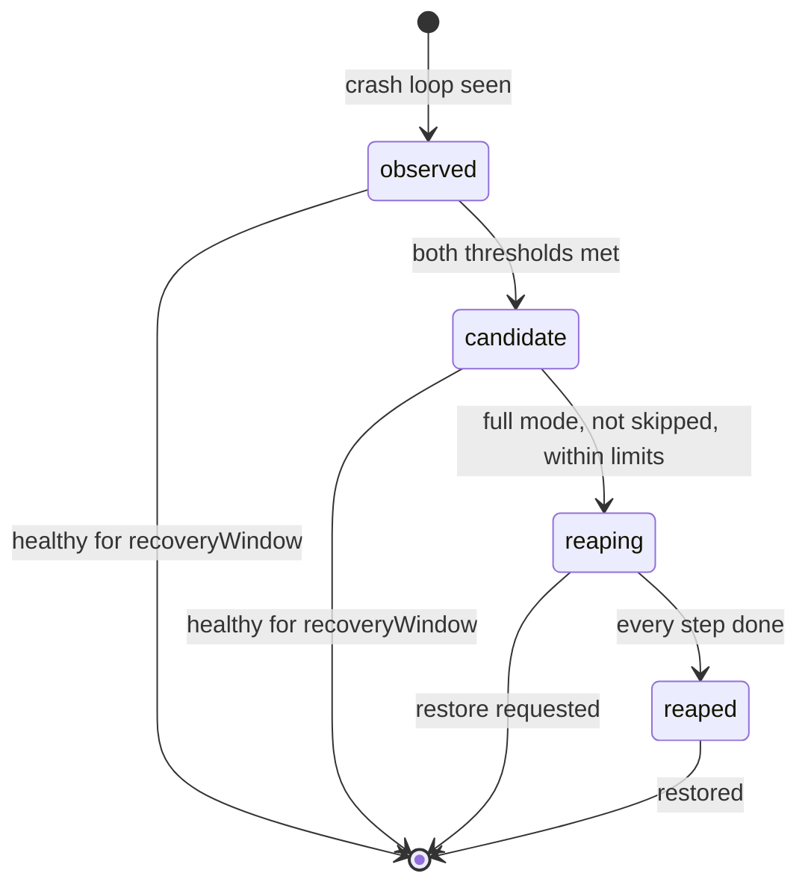

# How it works

This guide explains the model behind k8s-reaper: how it decides that a
workload is crash-looping, the states a workload moves through, why it skips
some workloads, the limits that keep full mode careful, and what it writes to
your cluster. Read it once you have the reaper installed
([getting started](getting-started.md)) and want to predict what it will do.
Field-by-field settings are in [configuration](configuration.md), and the ways
back from a reap are in [restoring a workload](restoring-a-workload.md).

## 1. The cycle

The reaper runs one loop, a cycle, every `cycleInterval` (60 s by default).
Each cycle has three steps:

1. **Snapshot.** It takes the current view of the cluster from its watch
   caches: Deployments, StatefulSets, DaemonSets, CronJobs and their Jobs,
   Pods, ReplicaSets, Namespaces, Flux HelmReleases, HPAs and, when KEDA is
   installed, ScaledObjects. It also reads `ReaperConfig/default`.
2. **Decide.** From that snapshot and the config alone it computes a plan for
   every workload in scope. This step reads no clock and calls no API, so the
   same snapshot always gives the same plan.
3. **Execute.** It writes its own record onto each workload (state label,
   timestamps, plan), records Events, and, in full mode only, carries out the
   plan.

The global mode is not an input to the decide step. Report mode and full mode
compute the same plan and publish the same `reaper.boop.ninja/plan`
annotation, byte for byte. The only difference is that full mode then runs the
plan. What you read in report mode is exactly what full mode will do.

A cycle can also start early. Setting the restore annotation, scaling a reaped
workload up, or resuming a reaped CronJob starts a cycle straight away, so a
restore normally takes seconds, not a full interval.

Everything the reaper knows is stored on the objects themselves, so a restart
of the reaper loses nothing. A crash loop that started before the restart
keeps its start time, and a reap that was interrupted halfway is finished on
the next cycle, not started over.

## 2. What counts as crash-looping

### A crash-looping container

A container, app or init, is crash-looping when it is **not ready** and
either:

- it is waiting with reason `CrashLoopBackOff`, or
- it is terminated right now with a non-zero exit code.

### A crash-looping workload

The reaper follows each pod to the workload that owns it:

| Pod owned by                     | Workload       |
| -------------------------------- | -------------- |
| ReplicaSet owned by a Deployment | the Deployment |
| StatefulSet                      | the StatefulSet |
| DaemonSet                        | the DaemonSet  |
| Job                              | ignored        |
| anything else, or nothing        | unsupported    |

A workload is crash-looping while any container in any of its pods is. The
reaper notes when it first saw that in `reaper.boop.ninja/crashloop-since`.

It becomes a **candidate** once **both** thresholds are met:

| Threshold                      | Default | Meaning |
| ------------------------------ | ------- | ------- |
| `detection.crashLoopDuration`  | `30m`   | Time since `crashloop-since`. |
| `detection.minRestarts`        | `10`    | Restart count of the crash-looping container with the most restarts. |

A team can raise either threshold for one workload with an annotation, never
lower it. See [configuration](configuration.md#thresholds-per-workload-annotations).

### Recovery

When no container is crash-looping any more, the reaper writes
`reaper.boop.ninja/healthy-since` and waits. Only after
`detection.recoveryWindow` (`10m` by default) of continuous health does it
clear its state and record `CrashLoopRecovered`. If the workload crashes again
inside the window, `healthy-since` is dropped and the original
`crashloop-since` is kept. A container that runs for a few seconds between
crashes therefore never resets the clock.

### What does not count

| Situation | Why it is not a crash loop |
| --------- | -------------------------- |
| `ImagePullBackOff`, `ErrImagePull` | The container never started, so nothing restarts and nothing is wasted. |
| `Pending` pods, `ContainerCreating` | Nothing has run yet. |
| Pods of a Job, including a CronJob's Jobs | Jobs stop by themselves (`backoffLimit`). CronJobs are judged by their Jobs' outcomes instead, see [CronJobs](cronjobs.md). |
| Bare pods, or pods owned by a kind not in the table above | There is no workload to act on. They are counted per namespace in `reaper_unowned_crashlooping_pods` and logged. They get no state and no Event. |
| A workload with `spec.replicas: 0` | Nothing is running. Any state the reaper held is cleared without an Event. |

A workload that crash-loops while some of its replicas are still available is
a crash loop, and can become a candidate. It is never acted on, though: see
`PartiallyAvailable` in [section 5](#5-skip-reasons).

## 3. The state lifecycle

The reaper keeps one label on each workload it is tracking,
`reaper.boop.ninja/state`. It is absent when the reaper holds nothing.



| State       | Meaning |
| ----------- | ------- |
| `observed`  | Crash-looping, below at least one threshold. |
| `candidate` | Both thresholds met. A plan is published. Report mode stays here; so does a skipped candidate in full mode. |
| `reaping`   | Full mode has started the reap steps. A workload passes through this state within one cycle; you only see it if a step failed or the reaper stopped halfway. |
| `reaped`    | Stopped: scaled to 0, or a CronJob suspended. |

How state is cleared (the `[*]` on the right):

- **Recovered.** Healthy for `recoveryWindow` from `observed` or `candidate`.
  Event `CrashLoopRecovered`.
- **Restored.** From `reaped`: the restore annotation, a manual scale-up, a
  manual CronJob resume, or `reaper.boop.ninja/mode=off`. From `reaping`: the
  restore annotation or `mode=off`. Event `Restored`. See
  [restoring a workload](restoring-a-workload.md).
- **Forgotten.** From `observed` or `candidate`, without an Event: the
  workload was scaled to 0 by someone else, opted out with `mode=off`, or
  (for a CronJob) suspended by someone else.

In full mode a reapable candidate goes from `candidate` through `reaping` to
`reaped` in the same cycle.

A restored workload starts from nothing. If it crash-loops again, it is
`observed` again, and the full `crashLoopDuration` must pass before it can be
reaped again.

## 4. The plan annotation

From `candidate` onward, the workload carries its plan in
`reaper.boop.ninja/plan`, as compact JSON:

```sh
kubectl get deploy -n shop api \
  -o jsonpath='{.metadata.annotations.reaper\.boop\.ninja/plan}{"\n"}'
```

A candidate that full mode would reap lists every step, in order:

```json
{"actions":[{"recordReap":{"originalReplicas":2}},{"disableKustomizeReconcile":"Deployment/shop/api"},{"scaleTo":{"replicas":0}},"markReaped"]}
```

A skipped candidate names the reason and keeps the steps it would have run:

```json
{"skip":"PartiallyAvailable","would":[{"recordReap":{"originalReplicas":3}},{"scaleTo":{"replicas":0}},"markReaped"]}
```

The steps you can see:

| Step                         | What it does |
| ---------------------------- | ------------ |
| `recordReap`                 | Writes the state `reaping`, `original-replicas` and `reason` onto the workload. For a kustomize-managed workload, the Flux reconcile annotation is set in this same write. |
| `disableKustomizeReconcile`  | Sets `kustomize.toolkit.fluxcd.io/reconcile: disabled` on the workload. See [Flux](flux.md). |
| `holdHelmRelease`            | Suspends the owning HelmRelease (`suspend: true`) or, if it is already suspended, only records the hold. See [Flux](flux.md). |
| `scaleTo`                    | Scales the workload through its `scale` subresource. |
| `suspendCronJob`             | Sets `spec.suspend: true` on a CronJob. |
| `markReaped`                 | Writes `reaped-at` and the state `reaped`. |

Each step is recorded before the next one starts, and each can be detected
from the objects. If a step fails, the reaper records `ReapFailed` and the
next cycle runs only the steps that are not done yet.

## 5. Skip reasons

A candidate that will not be reaped gets a skip reason, a `ReapSkipped`
Warning Event (when the reason first appears or changes), and the
`reaper_workload_skipped` metric. Each candidate has exactly one reason. When
several apply, the first in this table wins:

| Skip reason           | When |
| --------------------- | ---- |
| `CannotScaleToZero`   | The workload is a DaemonSet. DaemonSets are always report-only, and their plan lists no steps. |
| `ManagedByController` | The Deployment or StatefulSet has a controller `ownerReference`, for example from a database operator. Acting would race that controller. |
| `ManagedByAutoscaler` | A KEDA ScaledObject targets the workload. It would scale it back up. (An HPA is fine: it stops acting at 0 replicas and resumes after a restore.) |
| `ReportOnlyScope`     | A `reaper.boop.ninja/mode=report` label or annotation applies, or the workload needs a Flux step that is turned off (`flux.kustomize` or `flux.helmRelease` set to `false`). |
| `PartiallyAvailable`  | At least one replica is still available (`availableReplicas` for a Deployment, `readyReplicas` for a StatefulSet). The reaper never causes an outage. |
| `RateLimited`         | `limits.maxReapsPerCycle` was reached this cycle. |
| `ReapCeilingReached`  | `limits.maxReaped` workloads are already reaped or being reaped. |

A workload with `mode=off` has no skip reason: it is ignored entirely. A pod
without a supported owner has no workload to skip; it is counted in
`reaper_unowned_crashlooping_pods` instead.

## 6. Safety limits

Two limits bound what full mode can do, however many workloads break at once
(a registry outage, a bad node):

| Limit                     | Default | Effect |
| ------------------------- | ------- | ------ |
| `limits.maxReapsPerCycle` | `1`     | New reaps started in one cycle. |
| `limits.maxReaped`        | `5`     | No new reap starts while this many workloads are `reaping` or `reaped`. |

Candidates are taken in a fixed order:

1. longest crash-looping first (oldest `crashloop-since`, or `failing-since`
   for a CronJob);
2. then by namespace, then by name.

Only candidates that would otherwise be reaped use up the limits. A
`PartiallyAvailable` candidate, for example, does not take the cycle's one
reap. The rest are skipped with `RateLimited` or `ReapCeilingReached` and
looked at again next cycle. Paused CronJobs count toward the same limits as
Deployments and StatefulSets.

A reap that is already `reaping` is always finished, whatever the limits say.
Restores are never limited.

The limits are part of the plan, so they apply in report mode too. With
several candidates and the default `maxReapsPerCycle: 1`, report mode shows
one plan with `actions` and the others as `RateLimited`. Read the `would` list
of those plans to see what full mode would do to them. Setting
`maxReapsPerCycle: 0` turns every candidate into a skip, even in full mode.

## 7. Scope and exclusions

Before deciding anything, the reaper drops every workload outside its scope:

- **Its own namespace** is always out, whatever the config says.
- **`scope.excludeNamespaces`** is out. The default is `kube-system`,
  `kube-public`, `kube-node-lease` and `flux-system`.
- **`scope.includeNamespaces`**, if set, is the only thing in. Empty means
  every namespace.

Entries are names or globs (`slam-*`). A namespace that matches both lists is
excluded. Setting a list replaces its default; see
[configuration](configuration.md#scope).

Out of scope means not looked at at all: no state, no Events, and no restore.
A workload already reaped in a namespace you then exclude stays at 0 until
you restore it. Restore first, then exclude.

## 8. Mode: report, full and the mode label

The global mode is set in the ReaperConfig:

| Mode     | What happens |
| -------- | ------------ |
| `report` | The default. The reaper publishes plans, labels and Events and changes nothing else. |
| `full`   | The same, and then it runs the plans. |

A namespace or a workload can lower its own mode with the
`reaper.boop.ninja/mode` label or annotation:

| Value    | Effect |
| -------- | ------ |
| `off`    | Ignored entirely: not observed, annotated or reported. State the reaper held is cleared; a reaped workload is restored first. |
| `report` | Observed and reported, never reaped. Candidates are skipped with `ReportOnlyScope`. |

The effective mode is the most restrictive of the global mode, the namespace
and the workload, in the order `off` < `report` < `full`. There is no `full`
value, so a label can only lower the mode. On one object, the label wins over
the annotation. Any other value is ignored, and the reaper records a
`ConfigInvalid` Warning Event on that object.

### What report mode changes

In report mode the reaper writes only:

- its own `reaper.boop.ninja/*` annotations and the state label;
- Events;
- the ReaperConfig status.

Restores are the exception. A restore runs in every mode, because it only
undoes what the reaper did earlier, and so does releasing a HelmRelease hold
for a workload that has gone. Both can change replicas, Flux annotations or
HelmReleases in report mode.

### DaemonSets

A DaemonSet runs one pod per node; it has no replica count to set to 0. A
crash-looping DaemonSet is observed and can become a candidate, but it is
always skipped with `CannotScaleToZero`, in both modes.

## 9. What the reaper writes

### On a workload (Deployment, StatefulSet, DaemonSet, CronJob)

| Key | Kind | When |
| --- | ---- | ---- |
| `reaper.boop.ninja/state` | label | While the reaper holds any state. |
| `reaper.boop.ninja/crashloop-since` | annotation | From `observed` on (not on CronJobs). |
| `reaper.boop.ninja/healthy-since` | annotation | While a tracked workload waits out the recovery window. |
| `reaper.boop.ninja/plan` | annotation | From `candidate` on. |
| `reaper.boop.ninja/original-replicas` | annotation | When a reap starts (not on CronJobs). |
| `reaper.boop.ninja/reason` | annotation | When a reap starts. |
| `reaper.boop.ninja/previous-reconcile` | annotation | When it set the Flux reconcile annotation. |
| `reaper.boop.ninja/helmrelease` | annotation | When it holds the owning HelmRelease. |
| `reaper.boop.ninja/reaped-at` | annotation | When the reap is done. |
| `reaper.boop.ninja/failing-since`, `failed-runs`, `last-failed-job` | annotation | CronJobs only, see [CronJobs](cronjobs.md). |
| `kustomize.toolkit.fluxcd.io/reconcile` | annotation | Full mode, Flux Kustomization-managed workloads, see [Flux](flux.md). |

The label and annotations sit on the workload's own metadata, never on the pod
template, so writing them never starts a rollout. In full mode the reaper also
changes `spec.replicas` (through the `scale` subresource) or a CronJob's
`spec.suspend`.

### On a HelmRelease

`reaper.boop.ninja/held-for`, `reaper.boop.ninja/suspended-by-reaper`,
`reaper.boop.ninja/previous-reconcile`, `spec.suspend`, and possibly
`kustomize.toolkit.fluxcd.io/reconcile`. See [Flux](flux.md).

### Elsewhere

- **Events** (`events.k8s.io/v1`, reporting controller
  `reaper.boop.ninja/k8s-reaper`), only when something changes, never every
  cycle. The reasons are listed in
  [getting started](getting-started.md#42-events).
- **The ReaperConfig status**: counts per state, the active generation and
  the `Valid` and `Ready` conditions.
- **Metrics** on `:8080/metrics`. See [monitoring](monitoring.md).

### Keys it reads but never writes

`reaper.boop.ninja/mode` and the four threshold overrides
(`crashloop-duration`, `min-restarts`, `failing-duration`, `min-failed-runs`)
belong to people. The reaper never changes or deletes them.
`reaper.boop.ninja/restore` is set by people, and the reaper removes it once
it has acted on it.

## 10. What the reaper never does

- It never deletes anything: no pods, Jobs, workloads or HelmReleases.
- It never stops a running Job. Suspending a CronJob only stops new runs.
- It never changes a pod template, image or any spec field other than
  `replicas` (Deployments, StatefulSets), `suspend` (CronJobs, HelmReleases).
- It never touches a Flux Kustomization object. It only annotates the objects
  a Kustomization applies.
- It never changes an annotation or label it did not write, apart from the
  Flux reconcile annotation, whose earlier value it records and puts back.
- It never acts on its own namespace, an excluded namespace, or a workload
  with `mode=off`.
- It never reads Secrets through the Kubernetes API. Notification URLs come
  from mounted files, see [notifications](notifications.md).
- In report mode, it never changes replicas, Flux objects or CronJobs, except
  to undo an earlier reap.

## Next steps

- [Flux](flux.md): how the reaper keeps Flux from undoing a reap.
- [CronJobs](cronjobs.md): failing streaks and suspension.
- [Restoring a workload](restoring-a-workload.md): every way back.
- [Troubleshooting](troubleshooting.md): when the reaper does not do what you
  expect.
